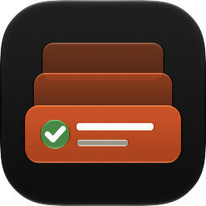

# App icon (issue #1)

Concept 5, Triage Stack, built as a layered Icon Composer document at
`MR Command Center/AppIcon.icon`. Open it in Icon Composer (Xcode → Open Developer Tool) to edit.

- **Background:** the "Your Move" orange (`Theme.yourMove`, `#D9480F`) as a vertical gradient.
- **Queue group:** the two back cards, translucent glass.
- **Ready card group:** the front card, the green check (`Theme.ready`) and two text lines. The title
  line turns white in dark mode, where the system draws the front card in orange.

These previews were rendered with Icon Composer's `ictool` at 256 px:

| Default | Dark | Tinted light | Tinted dark | Clear light | Clear dark |
| :-: | :-: | :-: | :-: | :-: | :-: |
|  |  |  |  |  |  |

To regenerate one:

```bash
"/Applications/Xcode.app/Contents/Applications/Icon Composer.app/Contents/Executables/ictool" \
  "MR Command Center/AppIcon.icon" --export-image --output-file docs/app-icon/Dark.png \
  --platform macOS --rendition Dark --width 256 --height 256 --scale 1
```
